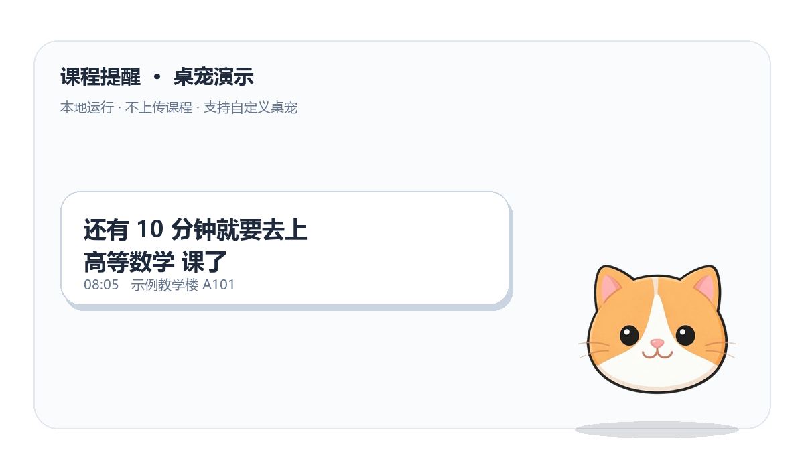

## ⚠️ 关于作者、版权与维护声明

1. **能力声明**：本人并非专业程序员，代码能力有限。本项目绝大部分代码由 AI 辅助生成，主要供个人自用。程序内部难免存在不够优雅、甚至仍有 Bug 的地方，恳请各位前辈和大佬多多包涵；如果能顺手指点一二，我将感激不尽。
2. **维护说明（关于 Issue 和 PR）**：非常感谢您愿意阅读或修改我的代码！但由于本人精力有限，可能无法及时回复 Issue，对 PR 的审查和合并也可能比较缓慢，请您谅解。如果您急需使用，强烈建议直接 Fork 一份自行修改。
3. **素材与版权声明**：本开源程序不包含任何受版权保护的商业形象或素材。项目自带的默认猫猫仅作为示例桌宠，您可以使用自己的 `pet.png` 替换。所有演示及使用的图片素材，请确保符合相关版权规定。
4. **已知开源依赖与数据源**：本项目遵循 MIT License，依赖图像处理库 **Pillow**；法定节假日数据来源于开源项目 **holiday-cn**（MIT 协议）。
5. **开源素材提醒**：本人已尽力排查代码中使用的开源资源，但受限于能力，若您在代码中发现任何未声明来源的开源素材，请务必通过 Issue 提醒我，我会第一时间核实并补充声明。

---

# 课程提醒（Class-Reminder）

一个面向 Windows 的本地课程提醒小工具。使用 Python 标准库 `tkinter` 构建界面，使用 Pillow 处理桌宠图片；不接入云端服务，不调用大模型，不上传课程数据，除首次下载节假日数据外不联网。



> 效果图由程序自动生成。出厂自带默认猫猫作为桌宠，您可以自行准备 `pet.png` 替换。

## 功能

- **课程管理**：添加、编辑、删除课程，按星期与开始时间自动排序。
- **网格课表**：固定的 12 节作息表，周一至周日完整网格；支持自动识别节次、手动指定节次、跨节次合并显示。
- **渐进式提醒**：基础提前提醒 + 最多 3 次额外提醒，可分别设置提前分钟和自定义文字。
- **桌宠气泡**：透明桌宠、动态时钟、长文本自动换行；基础提醒支持 60 秒停留、180 秒后贪睡重弹。
- **节假日与补班**：读取本地节假日数据；节假日静默跳过，补班日可按映射的星期上课。
- **本地优先**：课程、配置、补班和节假日数据均保存在程序所在目录，不上传网络。

## 快速开始

1. 安装 Python 3.10 或更高版本。
2. 安装依赖：

   ```bash
   pip install -r requirements.txt
   ```

3. 可选：复制示例课程文件，按自己的课表修改：

   ```bash
   copy courses.example.json courses.json
   ```

   程序首次运行也会自动创建空的 `courses.json`。

4. 启动：

   ```bash
   python main.py
   ```

5. 将透明背景的桌宠图片命名为 `assets/pet.png` 放入 `assets/`。如果没有 `pet.png`，程序会自动使用项目自带的 `assets/default_pet.png`；两者都不存在时会禁用提醒并给出提示。

## 数据与隐私

以下文件属于个人数据，已在 `.gitignore` 中排除，不会被提交到仓库：

- `courses.json`
- `holidays.json`
- `makeup.json`
- `config.json`
- `assets/pet.png`

仓库只保留虚构的 `courses.example.json` 和可公开的 `assets/default_pet.png`。节假日数据仅在本地缺失当前年份时，从 [holiday-cn](https://github.com/NateScarlet/holiday-cn) 下载并保存到本地。

## 打包（可选）

```bash
python -m PyInstaller --onefile --noconsole --name 课程提醒 main.py
```

打包后的程序会从 exe 所在目录读取数据文件和 `assets/`，不会写入 PyInstaller 的临时解压目录。

## 开源依赖与致谢

- [Pillow](https://python-pillow.org/)：桌宠图片读取、Alpha 通道处理与缩放。
- [holiday-cn](https://github.com/NateScarlet/holiday-cn)：中国法定节假日与调休数据，MIT 协议。
- Python 标准库 `tkinter`：桌面界面。

## License

本项目采用 [MIT License](LICENSE)。
